# Student Services Dashboard (INFS605 Assignment 2)

Dipendra Kharal

This is a small microservices prototype for Osborne.AI. Admins and students can manage student profiles, look through a course catalogue and leave feedback on courses. When someone leaves feedback they get a confirmation "email" (it's a mock, the emails just go to a log).

Each service runs in its own container and has its own data. They talk to each other over HTTP, and everything from the outside goes through an nginx gateway on port 8080.

| Service | Tech | Port | Data | Where it came from |
|---|---|---|---|---|
| student-profile | Python/Flask | 5001 | student-db (Postgres) | starter files |
| course-catalogue | Python/Flask | 5002 | course-db (Postgres) | new |
| feedback | Python/Flask | 5003 | feedback-db (Postgres) | new |
| notification | Python/Flask | 5004 | in memory | new |
| gateway | nginx | 8080 | - | new |
| admin-frontend | React/Vite | 3000 | - | starter, extended |

## Architecture

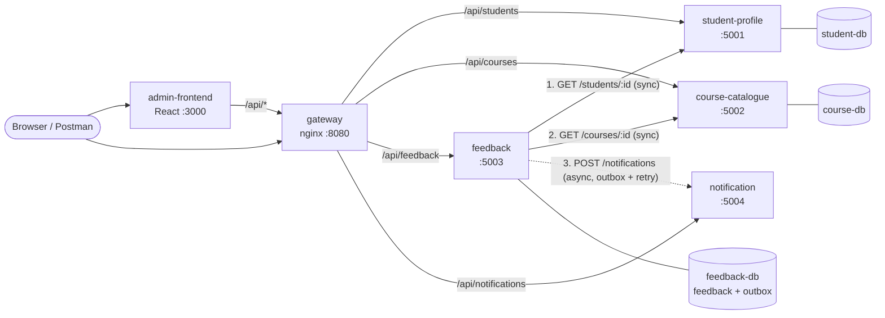

Plain text version, in case Mermaid doesn't render:

```
            Browser                      Postman
               │                            │
               ▼                            │
   admin-frontend (React) :3000             │
               │ /api/*                     │
               ▼                            ▼
       ┌──────────────── gateway (nginx) :8080 ─────────────────┐
       │                  │                  │                   │
       ▼                  ▼                  ▼                   ▼
 student-profile   course-catalogue      feedback ─────────► notification
      :5001             :5002              :5003    POST         :5004
       │                  │                  │   /notifications  (logs "emails")
       ▼                  ▼                  ▼
   student-db         course-db        feedback-db

 feedback also calls:  GET /students/{id}   student-profile   (sync)
                       GET /courses/{id}    course-catalogue  (sync)
                       POST /notifications  notification      (async, outbox + retry)
```

## Design

### Why these services

I split things up by what each part of the system is actually responsible for:

- student-profile looks after who the students are (name, email, attendance). Lots of other things in a uni system would need this, like grades or timetables, so it makes sense on its own.
- course-catalogue looks after what can be studied (code, title, credits, semester, lecturer). Courses get updated by different people and at different times than student records.
- feedback stores ratings and comments, and works out the average rating per course. It's the only service that needs both students and courses. If I had put it inside course-catalogue, the catalogue would suddenly depend on student data and notifications, which I didn't want.
- notification sends messages. It doesn't know anything about feedback, so other services (grades, room bookings) could use it later without writing their own email code.
- gateway just routes requests. It has no business logic.

I thought about splitting feedback further, e.g. a separate service for the rating summary, but that would be a tiny service with nothing real to own, so I left it.

### Coupling

Every service has its own folder, Dockerfile, requirements and database. No service imports code from another one or reads another service's files. They only talk through the REST APIs, using the Docker service names (`http://course-catalogue:5002` etc.), and those URLs are passed in as environment variables.

This means I can rebuild or restart one service, e.g. `docker compose up -d --build course-catalogue`, without touching the rest.

The only real dependency is feedback, which calls the other three. Even then it only relies on their API responses: it needs `name` and `email` from `GET /students/{id}`, and `code` and `title` from `GET /courses/{id}`. As long as those fields stay the same, the other services can change however they like. student-profile, course-catalogue and notification don't depend on anything.

### Who owns what data

| Data | Owner | Stored in | How others get it |
|---|---|---|---|
| Students, attendance | student-profile | student-db | GET /students/{id} |
| Courses | course-catalogue | course-db | GET /courses/{id} |
| Feedback, ratings | feedback | feedback-db | GET /feedback, GET /feedback/summary |
| Emails not sent yet (outbox) | feedback | feedback-db | only used inside feedback |
| Sent notifications | notification | memory | GET /notifications |

Because each service has its own Postgres container, there's no way for one service to read another's tables. The feedback table has `student_id` and `course_id` but no foreign keys, since those rows live in other databases. Instead feedback asks the owning service whether the student and course exist when the feedback is submitted.

One downside is that if a student or course gets deleted later, their old feedback still points at an id that doesn't exist anymore. For feedback history I think that's OK. In a bigger system the student service could send out a "student deleted" event and feedback could react to it.

### How the services communicate

| Call | Sync or async | Why | What happens if it fails |
|---|---|---|---|
| Client to any service (through the gateway) | sync | the user is waiting for the answer | nginx returns 502 |
| feedback to student-profile and course-catalogue | sync | feedback can't be saved until we know the student and course exist, and we need the email and course name for the message | 3 second timeout, then a 503 "A dependent service is unavailable". Nothing gets saved, so it's safe to try again |
| feedback to notification | async (outbox + retry) | the student doesn't need to wait for the email, and a failed email shouldn't throw away their feedback | feedback is still saved and the response has `notification_sent: false`. The email is retried every 15 seconds |

I went with plain HTTP instead of something like RabbitMQ. It covers what this system needs and every call can be tested in Postman. For the notification part, the outbox table plus the retry thread gives me most of what a queue would, without running another container.

### What happens when things go wrong

The lecturer's questions were a good checklist, so here's how each one is handled:

- If a service is down: every call between services has a 3 second timeout, so nothing hangs forever. The caller gets a 503 with a JSON error message.
- If the same request comes in twice (double click, client retry): a student can only leave one feedback per course, enforced by `UNIQUE (student_id, course_id)` in the database. The second request gets a 409 ("... has already submitted feedback for INFS605"). Course codes are unique too.
- If the notification fails, the feedback still goes through. The feedback row and its email are written to the database in the same transaction (the `notification_outbox` table), so even if the feedback service crashed straight after saving, the email wouldn't be lost.
- When the notification service comes back, a background thread in feedback checks for unsent emails every 15 seconds and sends them. In the UI each feedback shows "email sent" or "email queued, will retry". Screenshot 10 shows this happening.
- If the database is slow to start, each service waits for its own database health check before starting, and the containers restart automatically if they crash.

There are some limits I know about:

- An email could be sent twice. If notification accepts the email but the reply times out, feedback will think it failed and send it again. A real email service could ignore duplicates using the outbox id.
- The retry thread assumes there's only one feedback container. If there were several, two of them could send the same email. `SELECT ... FOR UPDATE SKIP LOCKED` would fix that.
- notification keeps its list of sent emails in memory, so the list is gone after a restart. The emails themselves aren't lost, because the outbox is in feedback-db.

### If this became a bigger system

- Use a proper message broker (RabbitMQ or Kafka) instead of polling the outbox. Feedback would publish a FeedbackSubmitted event and notification, or anything else, could subscribe to it.
- Give notification a database and connect it to a real email provider.
- Add login (JWT) at the gateway.
- Keep a local copy of student and course info in feedback, so it can still take feedback while those services are briefly down.
- Run gunicorn instead of the Flask dev server.

### Other bits

- The frontend and Postman only need to know `localhost:8080/api/...`. The Vite dev server forwards `/api` to the gateway, so there are no CORS problems in the browser.
- Database passwords and service URLs come from environment variables (`.env`, see `.env.example`). docker-compose.yml has defaults, so it still runs without a `.env` file.
- All my services log in the same format (`time [service] LEVEL message`) and return errors as JSON (`{"error": "..."}`) with a proper status code (400, 404, 409, 500 or 503).

## Running it

You need Docker Desktop (or Docker Engine with the compose plugin on Ubuntu). Postman is optional, for the tests.

```bash
cp .env.example .env            # optional, if you want to change the DB passwords
docker compose up -d --build    # first build takes a few minutes
docker compose ps               # should show 9 containers up, DBs "healthy"
```

Then go to:
- Dashboard: http://localhost:3000
- API through the gateway, e.g. http://localhost:8080/api/courses

To stop:

```bash
docker compose down       # stop, keeps the data
docker compose down -v    # stop and wipe the data (it re-seeds next time)
```

Logs (the mock emails show up as `EMAIL SENT to=...`):

```bash
docker compose logs -f notification
docker compose logs -f feedback
```

## API

Everything can be reached through the gateway at `http://localhost:8080/api/...` or straight on each service's port.

student-profile, `/api/students` (from the starter):

| Method | Path | What it does |
|---|---|---|
| GET | /students | list students |
| GET | /students/{id} | get one student |
| POST | /students | create, body `{name, email}` |
| PUT | /students/{id} | update name and/or email |
| DELETE | /students/{id} | delete |
| POST | /students/{id}/attendance | record attendance, body `{date, status}` |

course-catalogue, `/api/courses`:

| Method | Path | What it does |
|---|---|---|
| GET | /courses | list courses, sorted by code |
| GET | /courses/{id} | get one course |
| POST | /courses | create, body `{code, title, credits, semester, lecturer}` (only code and title are required). 409 if the code already exists |
| DELETE | /courses/{id} | delete |

feedback, `/api/feedback`:

| Method | Path | What it does |
|---|---|---|
| POST | /feedback | submit `{student_id, course_id, rating, comment}`. Rating is 1 to 5, comment is optional. Checks the student and course exist, saves it, then sends the email (queued if notification is down). 409 if the student already left feedback for that course |
| GET | /feedback | list feedback, including whether the email went out. Can filter with `?course_id=` or `?student_id=` |
| GET | /feedback/{id} | get one |
| GET | /feedback/summary | number of reviews and average rating for each course |

notification, `/api/notifications`:

| Method | Path | What it does |
|---|---|---|
| POST | /notifications | "send" an email, body `{to, subject, message}`. It's written to the log |
| GET | /notifications | list sent emails, newest first. Can filter with `?to=` |

Each service also has `GET /` as a health check, and the gateway has `GET /health`.

Example:

```bash
curl -X POST http://localhost:8080/api/feedback \
  -H "Content-Type: application/json" \
  -d '{"student_id": 1, "course_id": 1, "rating": 5, "comment": "Great course"}'
```

## Testing (Postman UATs)

The tests are in `postman/student-services-uat.postman_collection.json`. Import it into Postman and run the whole collection with the Runner. They need to run in order because later tests use the ids created by earlier ones. The collection makes its own test data and deletes it again at the end.

| ID | Test | Expected |
|---|---|---|
| UAT-01 | Gateway is up | 200 |
| UAT-02 | Admin can list students | 200, list not empty |
| UAT-03 | Admin can add a student | 201 |
| UAT-04 | Adding a student with no email is rejected | 400 |
| UAT-05 | Student can browse the course catalogue | 200, includes INFS605 |
| UAT-06 | Admin can add a course | 201 |
| UAT-07 | Duplicate course code is rejected | 409 |
| UAT-08 | Student can leave feedback on a course | 201, notification_sent true |
| UAT-09 | Same feedback sent twice is rejected | 409 |
| UAT-10 | Student gets a confirmation email | email addressed to the student |
| UAT-11 | Feedback for a student that doesn't exist | 404 |
| UAT-12 | Feedback for a course that doesn't exist | 404 |
| UAT-13 | Rating outside 1-5 | 400 |
| UAT-14 | Lecturer can see feedback for their course | 200, 1 entry |
| UAT-15 | Average rating is worked out | average = 4 |
| UAT-16, 17 | Clean up the test data | 200 |

You can't stop containers from Postman, so I tested the failure cases by hand (see below) and took screenshots 08 to 10 of them.

To run the tests without installing Postman, while everything is running:

```bash
docker run --rm --network microservices-net -v "$(pwd)/postman:/etc/newman" \
  postman/newman:6-alpine run student-services-uat.postman_collection.json \
  --env-var gatewayUrl=http://gateway --env-var baseUrl=http://gateway/api
```

Last run: 17 requests, 29 assertions, 0 failed.

### Testing the failure cases by hand

```bash
# notification down: feedback still saves, email is queued
docker compose stop notification
# submit some feedback -> 201 with "notification_sent": false
docker compose start notification
# within about 15 seconds the feedback log shows "Retry succeeded: delivered queued notification ..."
# and the dashboard shows "email sent"

# course-catalogue down: feedback can't be checked
docker compose stop course-catalogue
# submit some feedback -> 503, nothing saved
docker compose start course-catalogue

# duplicate: submit the same student + course twice, the second one gets a 409
```

## Folder structure

```
Microservice/
├── .env.example                 # DB passwords template, copy to .env
├── .gitattributes               # keeps *.sh files with LF line endings
├── .gitignore
├── docker-compose.yml           # 9 containers: 3 databases, 4 services, gateway, frontend
├── README.md
├── course-catalogue/            # new
│   ├── app.py
│   ├── Dockerfile
│   ├── init.sql                 # table + sample courses
│   └── requirements.txt
├── feedback/                    # new, calls the other three, has the outbox + retry
│   ├── app.py
│   ├── Dockerfile
│   ├── init.sql
│   └── requirements.txt
├── notification/                # new, mock email
│   ├── app.py
│   ├── Dockerfile
│   └── requirements.txt
├── gateway/
│   └── nginx.conf               # routes /api/... to each service
├── student-profile/             # from the starter
│   ├── app.py
│   ├── Dockerfile
│   ├── requirements.txt
│   └── wait-for-it.sh
├── postgres/
│   └── init.sql                 # students table + sample students
├── frontend/                    # React dashboard, extended from the starter
│   ├── src/
│   │   ├── App.jsx              # tabs + error message
│   │   ├── api.js               # small fetch helper, everything goes through /api
│   │   └── components/          # Students, Courses, Feedback, Notifications
│   ├── Dockerfile
│   ├── package.json
│   └── vite.config.js           # forwards /api to the gateway
├── postman/
│   └── student-services-uat.postman_collection.json
└── screenshots/
```

## Screenshots

| | |
|---|---|
| All containers running | 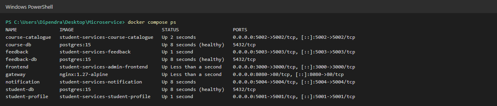 |
| Students tab | 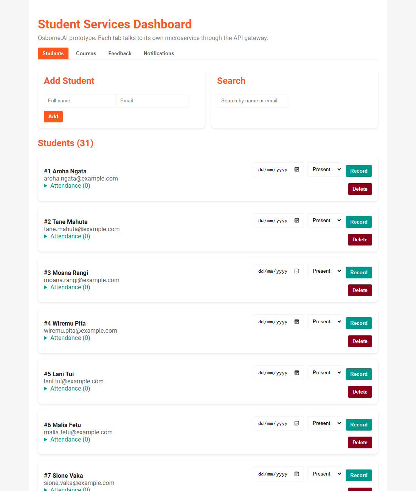 |
| Courses tab with ratings | 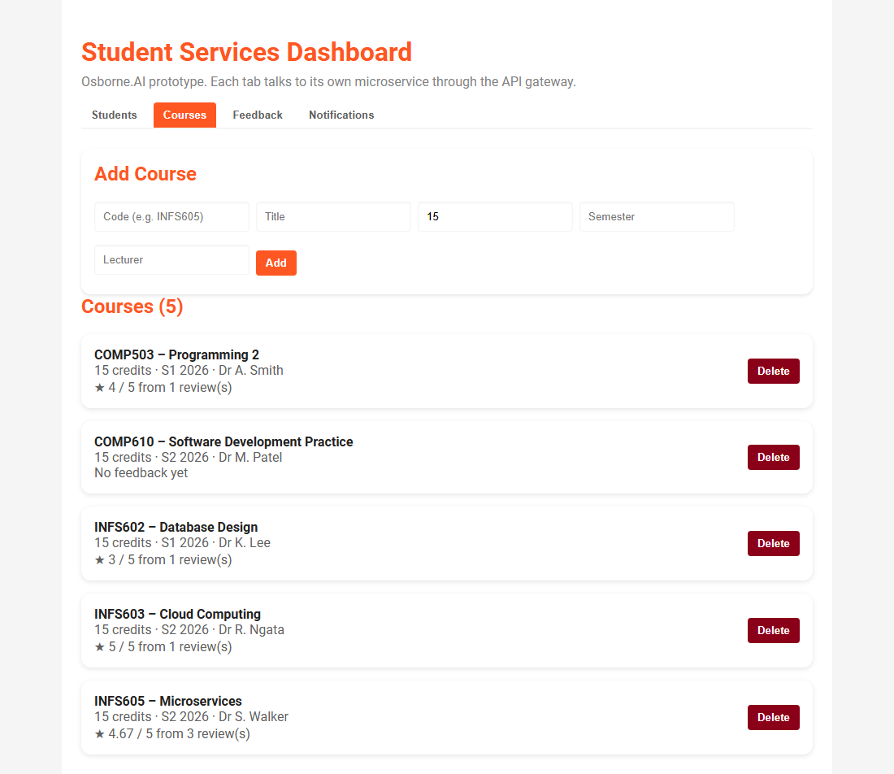 |
| Leaving feedback | 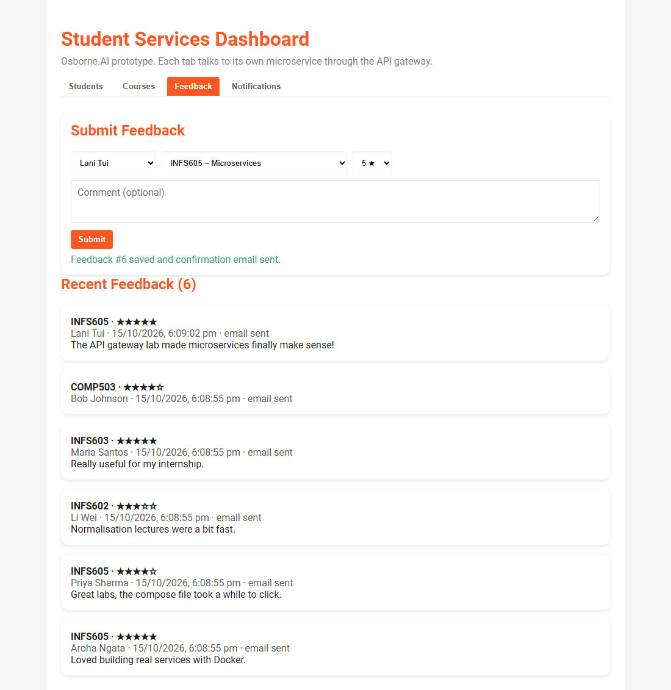 |
| Notifications tab | 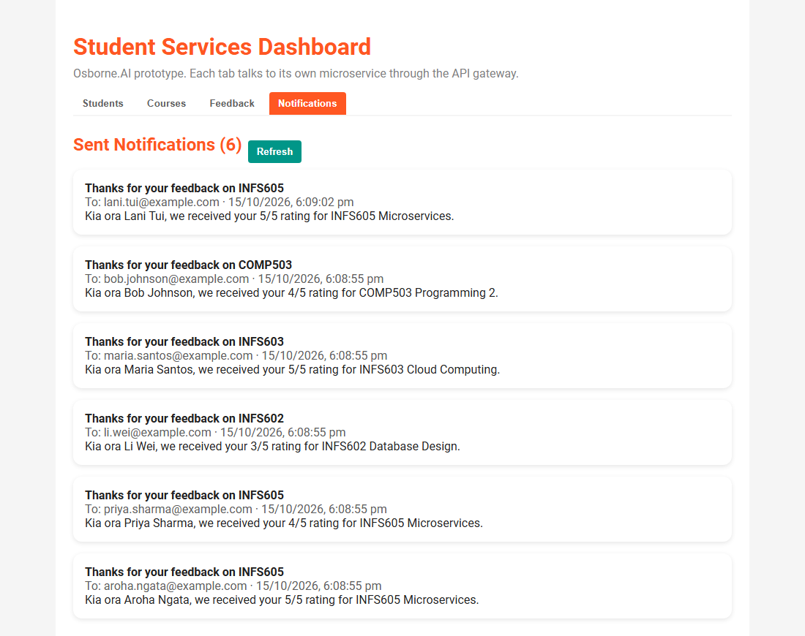 |
| Notification log | 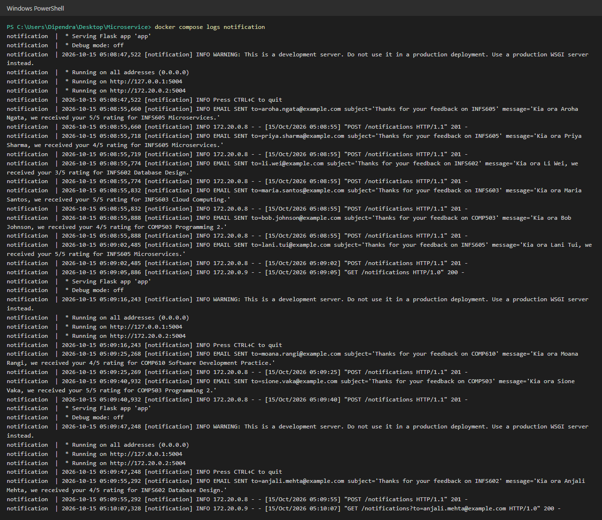 |
| Postman/Newman tests passing | 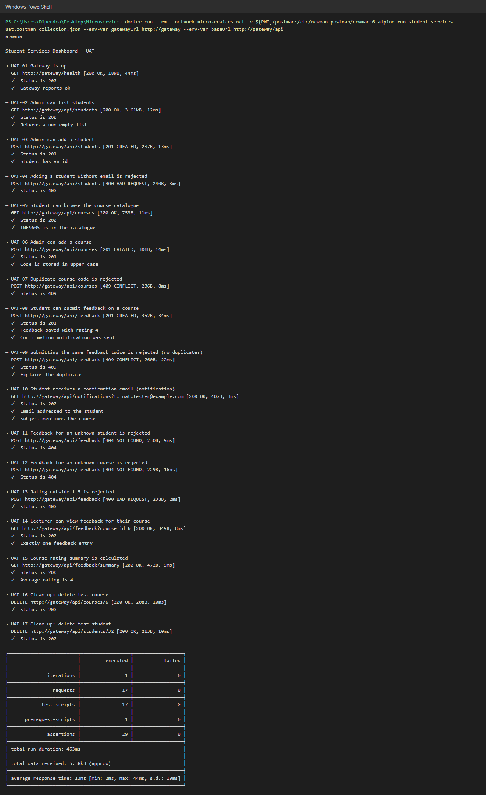 |
| Notification stopped: feedback still saved, email queued | 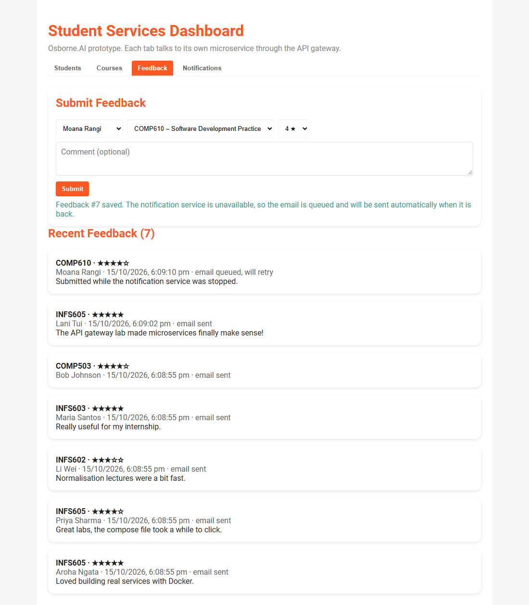 |
| One request going through all the services | 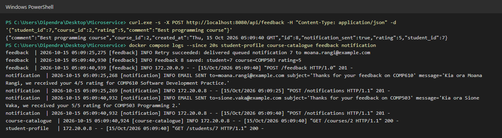 |
| Notification back up: queued email sent automatically | 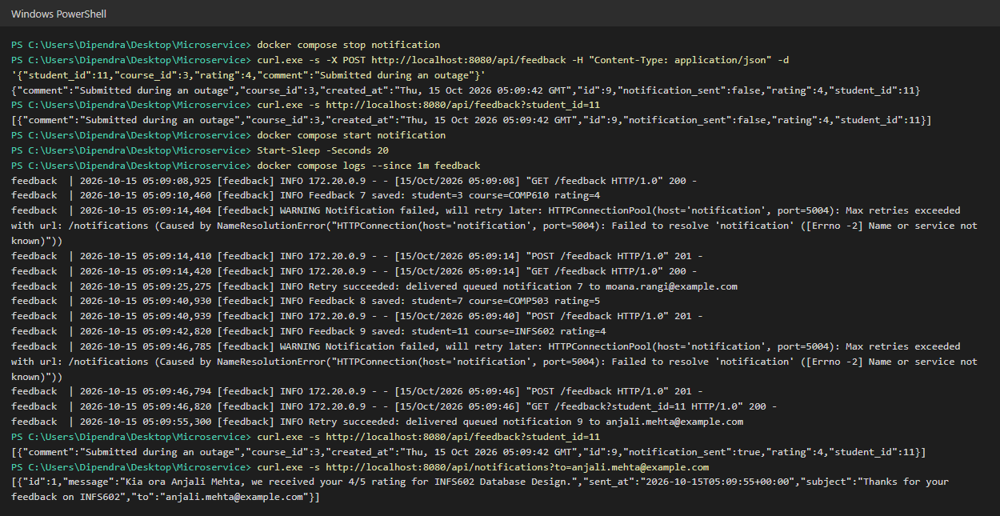 |

## Problems I ran into

1. The starter's `wait-for-it.sh` came down with Windows (CRLF) line endings because Git on Windows converts them by default. Bash inside the Linux container can't run it like that (`bash\r: No such file or directory`). I converted it to LF and added a `.gitattributes` rule so it stays that way.
2. `student-profile/init.sql` in the starter had a syntax error (a `;` before the last INSERT row). It wasn't actually being used, since compose mounts `postgres/init.sql`, so I deleted it.
3. The starter frontend called `http://localhost:5001` directly even though it had a proxy set up. I changed it to use `/api` so the browser only talks to one address and everything goes through the gateway.
4. On a fresh start, Postgres takes a few seconds before it accepts connections, and plain `depends_on` doesn't wait for that. I added `pg_isready` health checks and `condition: service_healthy` so the services wait for their database.
5. The starter's `.gitignore` had `.env/` and `.env.*`, which would have committed the real `.env` but ignored `.env.example`. I changed it to `.env` and `!.env.example`.

## Credits

This is built on the INFS605 starter files (https://github.com/JB-Connect/INFS605-Assignment2-Starter-Files, MIT License).

From the starter: the student-profile service, `postgres/init.sql`, the React/Vite setup, the styling in `frontend/src/index.css` (everything above the "Dashboard additions" comment) and the Students page layout (now `components/Students.jsx`, changed to go through the gateway).

Added for this assignment: the course-catalogue, feedback and notification services, the nginx gateway, the separate databases and compose changes, the tabs, the Courses/Feedback/Notifications pages, the CSS under "Dashboard additions", and the Postman tests.
